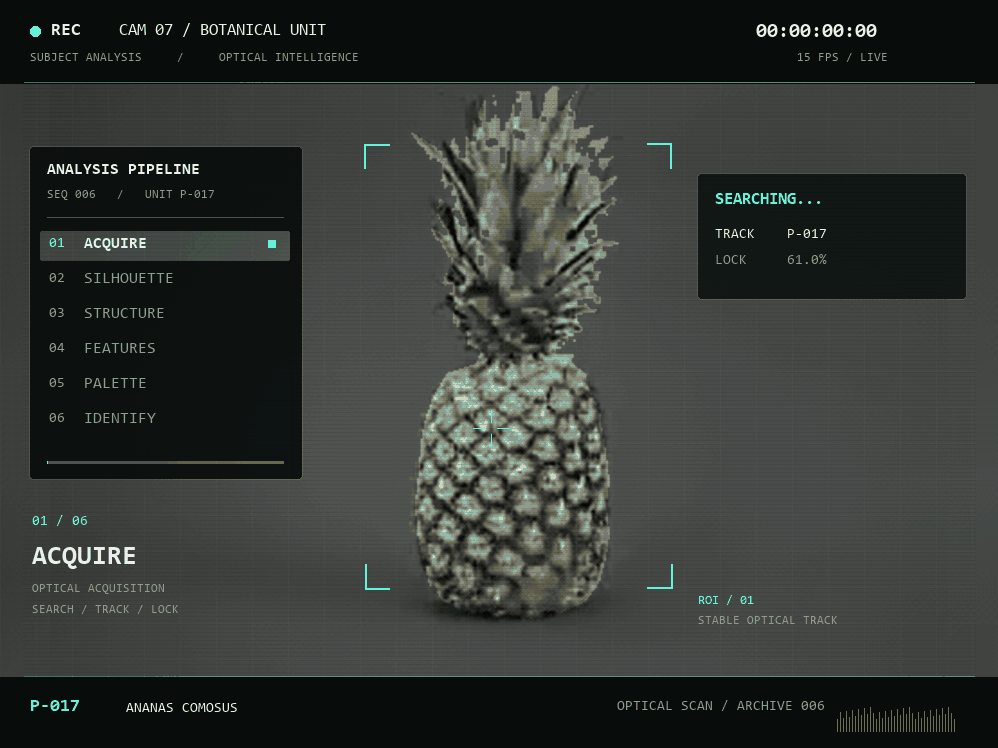

# Pineapple Subject Analysis

Бесшовная анимация ананаса в стиле камеры наблюдения: захват объекта,
силуэт, сетка и каркас, анализ деталей, палитра и идентификация.

**15 секунд · 15 fps · 225 кадров · 998 × 748**

- [Исходный промпт и согласованная адаптация](PROMPT.md)
- [Скачать GIF](pineapple-subject-analysis.gif)
- [Скачать MP4](pineapple-subject-analysis.mp4)
- [Исходное изображение](source.png)

Оригинальный рисунок сохранён: анимация собрана с помощью маски,
композитинга и увеличения исходных пикселей, без генеративной перерисовки.
Цвета рассчитаны методом k-means по выделенному объекту.
Confidence, match и threat — художественные элементы интерфейса.

GIF зациклен бесконечно; его первый и последний кадры совпадают.
MP4 без звука и готов к повторному воспроизведению.
